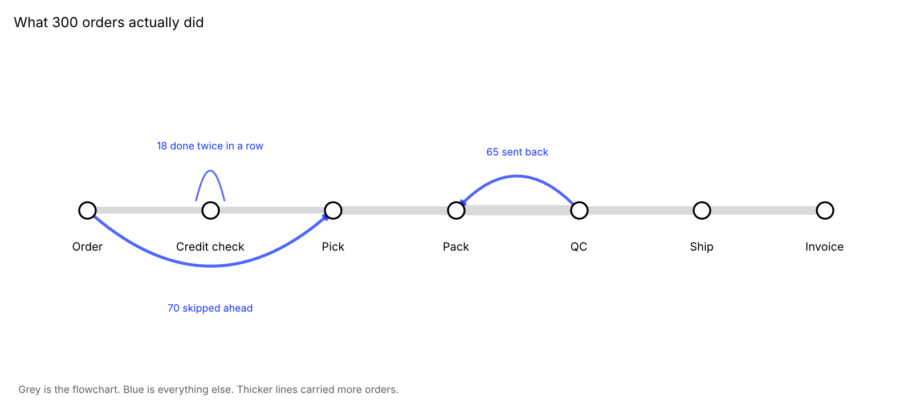

# Process X-ray

Every company has a flowchart of how an order is supposed to move. It also has a system that timestamps what really happened. The two rarely match, and the gap is usually where the time and money go.

This tool reads the timestamps and reports the gap: every path orders actually took, which steps were skipped or repeated, where orders sat waiting, and what the detours cost in hours.



## What it found in the sample

The sample is a made-up log of 300 orders. On paper there is one path with seven steps. In the log there are nine.

- **61% of orders followed the flowchart.** The other 39% did something else.
- **23% never had a credit check.** They went straight from order to picking.
- **16% were packed more than once.** They failed QC and went back.
- **The wait before QC is the bottleneck.** Orders sit there about nine hours, more than twice as long as anywhere else.
- **A repeat costs about 15 hours.** Orders that repeated a step took a median of 42.9 hours from order to invoice, against 27.9 for orders that stayed on the flowchart.

The orders that skipped the credit check finished two hours faster. That is the kind of finding that needs a conversation before a fix, because the shortcut is quicker and also the riskier one.

## Try it

You need Python 3.9 or newer.

```
pip install -r requirements.txt
python xray.py
```

The full output:

```
300 orders, 2,178 events, 9 different paths through one process.

On the flowchart: 182 orders (61%). Everything else: 118 (39%).

Paths, most common first
   182  60.7%  Order > Credit check > Pick > Pack > QC > Ship > Invoice   (the flowchart)
    57  19.0%  Order > Pick > Pack > QC > Ship > Invoice
    20   6.7%  Order > Credit check > Pick > Pack > QC > Pack > QC > Ship > Invoice
    14   4.7%  Order > Credit check > Credit check > Pick > Pack > QC > Ship > Invoice
    10   3.3%  Order > Credit check > Pick > Pack > QC > Pack > QC > Pack > QC > Ship > Invoice
     7   2.3%  Order > Pick > Pack > QC > Pack > QC > Ship > Invoice
     6   2.0%  Order > Pick > Pack > QC > Pack > QC > Pack > QC > Ship > Invoice
     2   0.7%  Order > Credit check > Credit check > Pick > Pack > QC > Pack > QC > Pack > QC > Ship > Invoice
     2   0.7%  Order > Credit check > Credit check > Pick > Pack > QC > Pack > QC > Ship > Invoice

Steps that were skipped
  Credit check: 70 orders (23%) never had it

Steps done more than once
  Credit check: 18 orders (6%)
  Pack: 47 orders (16%)
  QC: 47 orders (16%)

Where orders wait, in hours before the step starts
  QC             median   9.1   worst  17.1
  Credit check   median   3.5   worst   5.7
  Ship           median   2.1   worst   3.8
  Pick           median   2.0   worst   3.8
  Pack           median   1.6   worst   2.9
  Invoice        median   1.1   worst   1.9

Order to invoice, median hours (all orders: 28.6)
  on the flowchart   27.9   182 orders
  skipped a step     25.8   70 orders   (-2.1 against the flowchart)
  repeated a step    42.9   61 orders   (+15.0 against the flowchart)

What I'd look at first: the wait before QC. It is the longest queue in the process, and it is where the repeats pile up.
```

To save the picture at the top of this page:

```
python xray.py --map process_map.png
```

## The same questions in SQL

Most event logs live in a database, so the analysis is also written as plain SQL in `queries.sql`: paths per order, skipped and repeated steps, hand-offs between steps, and average waits. To run it against the sample:

```
python run_queries.py
```

The tests check that the SQL and the Python give the same answers.

## Use your own log

Export a CSV with these four columns, one row per event:

```
order_id,step,started_at,finished_at
SO-1001,Order,2026-09-01 08:22,2026-09-01 08:41
SO-1001,Credit check,2026-09-01 11:46,2026-09-01 13:53
```

Then tell the tool what the official steps are:

```
python xray.py --log my_events.csv --official "Received,Reviewed,Approved,Paid"
```

`order_id` can be anything that ties events together: an order, a ticket, a batch, an invoice.

## How it works

1. Sort each order's events by time. The list of steps is that order's path.
2. Count how many orders share each path. One of them is the flowchart. The rest are the findings.
3. For each order, check which official steps are missing and which steps appear more than once.
4. Measure the gap between one step finishing and the next one starting. The step with the longest gap in front of it is the bottleneck.
5. Compare order-to-invoice time for orders that stayed on the flowchart with orders that did not.

## What it does not know

- It shows what happened, never why. A skipped credit check might be a broken rule or a sensible exception for a trusted customer. Someone has to go and ask.
- It trusts the timestamps. If people log work hours after doing it, the waits will be wrong.
- The sample data is invented, with the problems put there on purpose. Real logs are messier and usually need cleaning first.
- It treats two steps with the same name as the same step. If your system uses different labels for the same thing, tidy those up before running it.

## Tests

```
python -m unittest
```

There are 16 tests. Six use a three-order log small enough to check by hand. The rest check the sample log, bad input, and that every SQL query agrees with the Python.

## Files

- `xray.py` is the analysis and the map.
- `queries.sql` holds the same analysis in SQL, and `run_queries.py` runs it.
- `make_log.py` creates the sample log. It is seeded, so it always produces the same 300 orders.
- `event_log.csv` is that sample log.
- `test_xray.py` holds the tests.
- `process_map.png` is the picture at the top of this page.
